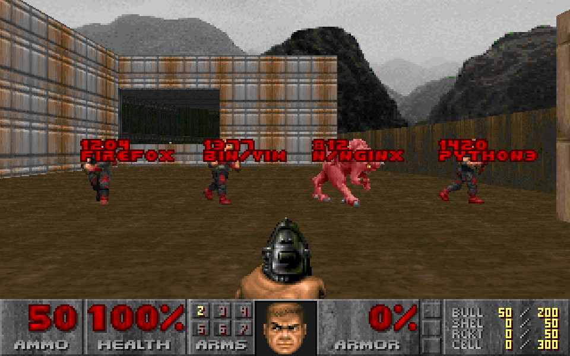
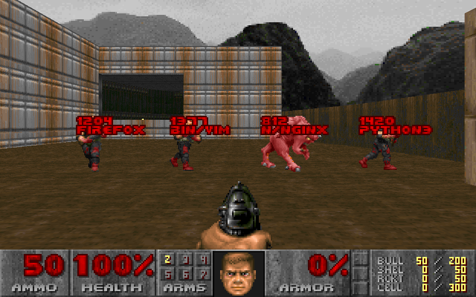
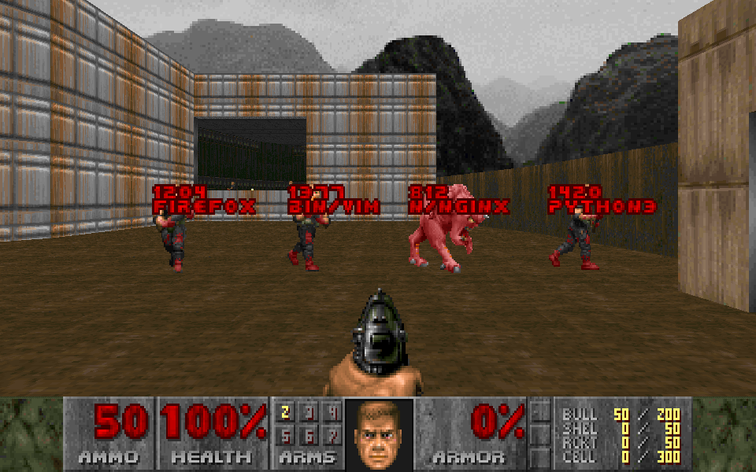
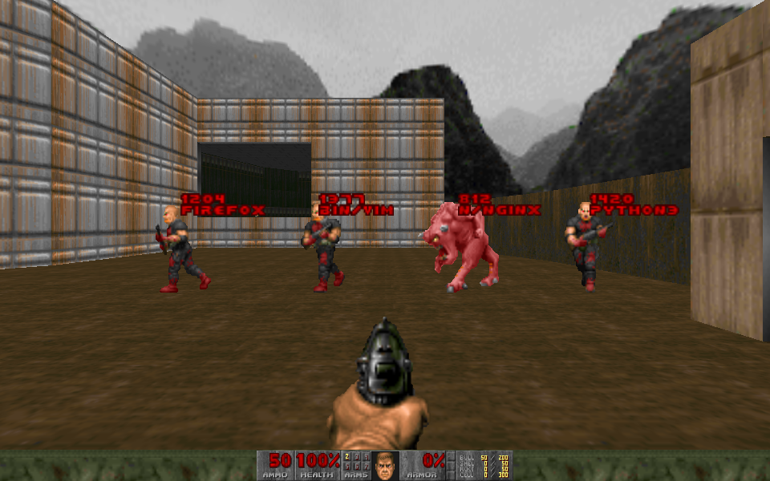
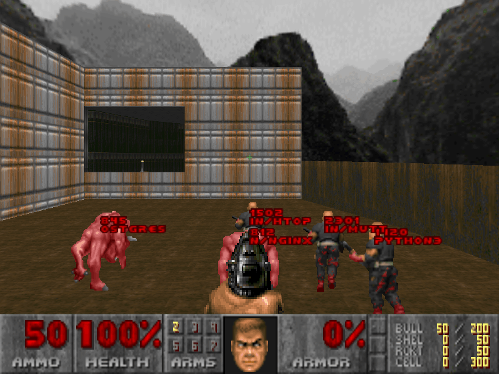
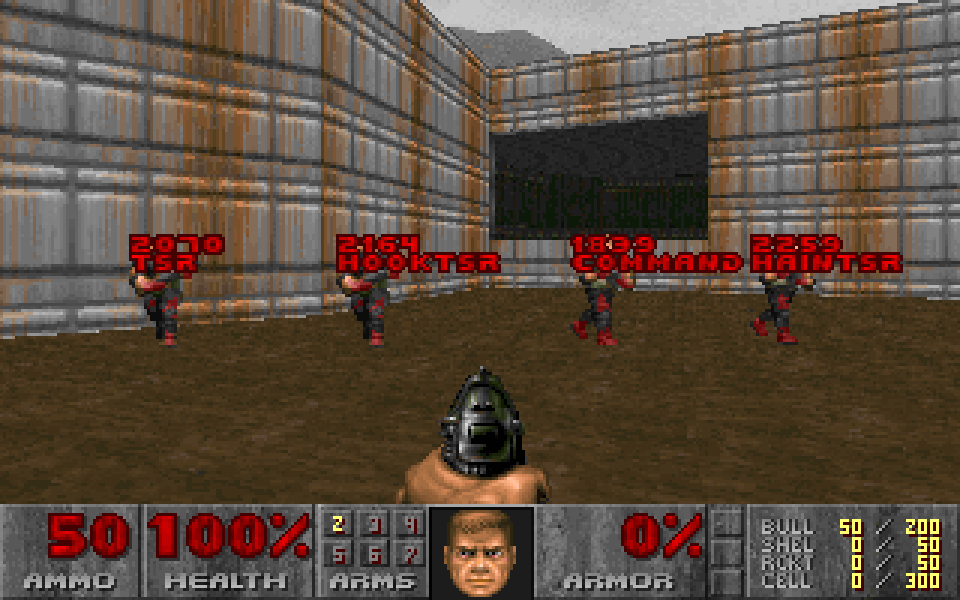
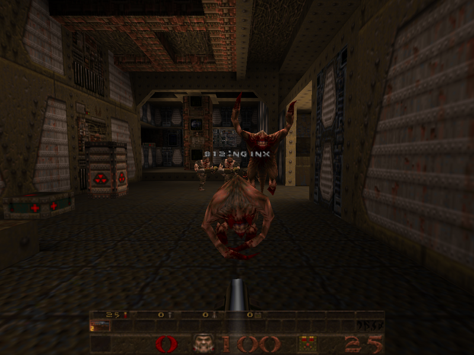
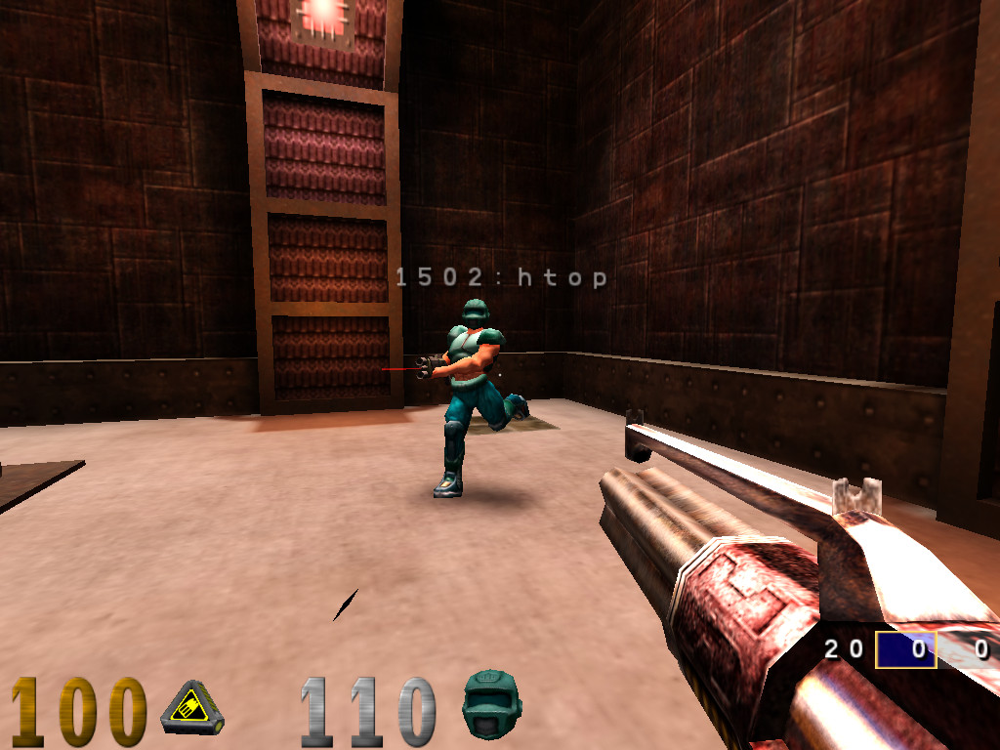
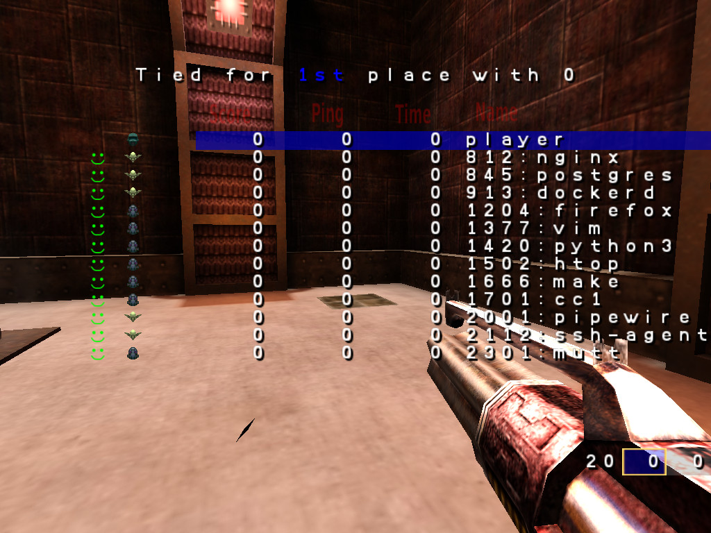

# psdoom-plus

A remake of [psDooM](https://psdoom.sourceforge.net), the Doom-based process manager, for current
Linux, BSD and Haiku systems and for modern Doom source ports.

In psDooM every running process is a monster. Shooting one lowers its priority (`renice`);
killing it kills the process. psdoom-plus brings that back on top of current engines:

| Engine | Status |
|---|---|
| og (id's linuxdoom-1.10 + SDL3) | **playable**: Linux, FreeBSD, OpenBSD, NetBSD, Haiku; MS-DOS (TSRs and drivers, DOSBox-X tested) |
| Chocolate Doom 3.1.1, Crispy Doom 7.2 | **playable**: Linux, FreeBSD, OpenBSD, NetBSD, Haiku |
| GZDoom 4.14.2, UZDoom 5.0.3 | **playable**: Linux, FreeBSD, Haiku |
| Woof! 16.0.0, DSDA-Doom 0.30.1 | **playable**: Linux, FreeBSD, Haiku |
| Quake 3: OpenArena 0.8.8 on ioquake3 | **playable**: Linux, FreeBSD, OpenBSD, NetBSD, Haiku ([processes as bots](engines/q3/README.md)) |
| Quake: QuakeSpasm 0.97.0 | **playable**: Linux, FreeBSD, OpenBSD, NetBSD, Haiku ([processes as monsters](engines/quake/README.md)) |

Platforms: Linux, FreeBSD, OpenBSD, NetBSD, DragonFly and Haiku, plus MS-DOS for the og engine
(remote processes over the network, or local TSRs and drivers as monsters). Anything else (containers, pods,
cloud apps) can plug in through psdoom-ng's `PSDOOM_NG_*_CMD` hooks, so kubedoom-style helpers
work unchanged.

Releases: see [CHANGELOG.md](CHANGELOG.md). Releases are source; the MS-DOS build is also a ready
zip (`psdoom-plus-<version>-dos.zip`, built by `make -C dos dist`; bring your own IWAD).

> **Warning:** this program sends real signals to real processes. In `classic` mode
> nothing is protected: it will happily kill your shell, your desktop or itself. Try it in a
> throwaway VM first.

The **og** engine (id's own linuxdoom-1.10 on SDL3) plays on Linux, FreeBSD, OpenBSD, NetBSD and
Haiku today, and so do Chocolate Doom and Crispy Doom; GZDoom, UZDoom, Woof! and DSDA-Doom play
on Linux, FreeBSD and Haiku. og also runs on MS-DOS, where the monsters are the resident programs
and drivers in DOS memory ([dos/](dos/README.md)). See [PLAN.md](PLAN.md) for the design and the
phases.

```sh
tools/psdev build og                       # fetch id's source, apply engines/og/patches, build
build/og/psdoom-og -nopsact                # dry run first: shows processes, signals nothing
build/og/psdoom-og -iwad freedoom1.wad     # modern mode (protected session, TERM then KILL)
build/og/psdoom-og -psclassic              # psDooM 2000: renice +5, kill -9, nothing protected
tools/psdev build crispy                   # or chocolate: build/crispy/psdoom-crispy
tools/psdev build uzdoom                   # or gzdoom: build/uzdoom/psdoom-uzdoom (needs GL)
tools/psdev build woof                     # or dsda: build/woof/psdoom-woof
tools/psdev build q3                       # Quake 3: build/q3/psdoom-q3 (ioquake3 + OpenArena data)
tools/psdev build quake                    # Quake: build/quake/psdoom-quake (Quake's id1/pak0.pak)
# another machine's processes: run psdoomd there, point any engine at it
PSDOOMD_TOKEN=<secret> psdoomd -l 192.168.1.10:6666          # on the target (modern rules apply)
PSDOOM_NET_TOKEN=<secret> build/og/psdoom-og -psnet 192.168.1.10:6666
```

## Screenshots

Shareware Doom's E1M1, each engine facing the same process table: postgres is a Demon (a
daemon), htop, mutt, python3 and nginx are zombiemen, and the label is the pid and the name.
(The process table is staged through the psdoom-ng hook, so nothing was actually killed.)

| | |
|---|---|
|  og (id's linuxdoom-1.10 on SDL3) |  Crispy Doom |
|  Woof! |  DSDA-Doom |
|  GZDoom |  UZDoom |
|  MS-DOS (DOSBox-X): COMMAND.COM and PSDOOM itself, both protected in modern mode | |

Quake (shareware E1M1, the same process table): daemons are Fiends and user processes Grunts;
the label shows while you look at one.



Quake 3 (OpenArena on ioquake3, the same process table): processes are bots named
`pid:command`, user processes are Grunts and daemons are Gargoyles.

| | |
|---|---|
|  htop under the crosshair |  the scoreboard |

## Layout

| Path | What |
|---|---|
| `PLAN.md` | design, decisions and phases |
| `CHANGELOG.md` | what each release contains |
| `libpsd/` | the process library every engine links: backends, kill modes, audit log ([API](libpsd/include/psd.h)) |
| `data/` | the original psDooM custom levels `psdoom1.wad` (Doom) and `psdoom2.wad` (Doom II) |
| `tools/psdev` | developer CLI: test VMs, `test unit [--vm <os>]` |
| `contrib/helpers/` | example psdoom-ng hook helpers: Docker containers, Kubernetes pods |
| `engines/og/` | og: upstream pin, patch series, SDL3 platform layer, psDooM glue |
| `engines/<engine>/` | other engines: `UPSTREAM` pin and `patches/`; the source is fetched into `src/` |
| `engines/quake/` | Quake: QuakeSpasm pin and patch, the monster glue, the `psdoom-quake` launcher ([README](engines/quake/README.md)) |
| `engines/q3/` | Quake 3: OpenArena's game code pin and patch, the bot glue, the `psdoom-q3` launcher ([README](engines/q3/README.md)) |
| `engines/common/` | glue shared by the Doom-family engines (`psdoom/`) and by GZDoom/UZDoom (`zdoom/`, ZScript) |
| `dos/` | the MS-DOS build of og (DJGPP + SDL3-DOS), the `mcb` backend's tools and tests ([README](dos/README.md)) |
| `.sdl-dos-ports/` | the sdl-dos-ports hub's shared DOS layer (git subtree; don't edit here) |
| `tests/vm/` | guest bootstrap and end-to-end tests (`tools/psdev test og --vm debian`) |
| `orig/` | the original psDooM 2000.05.03.b sources and downloads, kept for reference |

## Credits

- **Dennis Chao**: *Doom as an Interface for Process Management* (UNM, 1999), the original idea and code
- **David Koppenhofer**: psDooM (2000), built on XDoom
- **Udo Munk** and the XDoom contributors
- **id Software**: Doom (source released under the GPL in 1999), Quake (1999) and Quake III Arena (2005)
- the **QuakeSpasm** team, for the Quake engine
- the **OpenArena** team and the **ioquake3** project, for the free Quake 3 game and engine
- psdoom-ng / psdoom-ng1 and kubedoom, for keeping the idea alive

## Licence

psdoom-plus is free software under the **GNU General Public License, version 2 or (at your
option) any later version** (`GPL-2.0-or-later`), the same terms as psDooM and XDoom. See
[LICENSE](LICENSE).

Engine patch series are applied to upstream engines under those engines' own licences. A build
combined with GZDoom or UZDoom is distributed under GPL-3.0, which "or later" permits.
